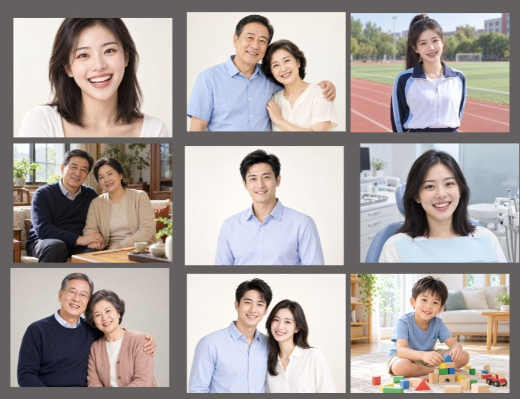
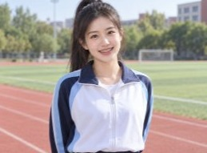
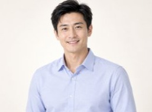
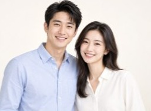
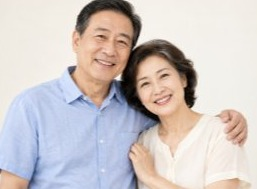
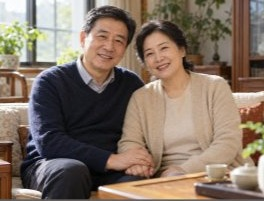
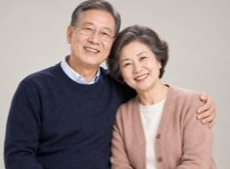
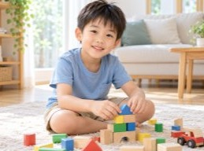

# 生成样例

以下图片由 `studio-portrait-master` 规则驱动生成，覆盖全部五类人物模式。
所有图片均为 4:3 画幅、亚洲面孔、头部完整露出、简洁背景。

> 图片为生成结果展示，用于说明规则覆盖面与质量基线。
> 样例分辨率为 253–264 × 189–201，源自生成平台的展示拼图，非原始出图尺寸。

## 总览



## 逐张说明

### 中青年单人（young-single）

| 样例 | 场景要点 |
|---|---|
|  | 浅色背景棚拍，清爽笑容，自然半身 |
|  | 户外跑道场景，运动装配色，环境虚化 |
|  | 浅蓝衬衫棚拍，正面略侧，温和表情 |
|  | 医疗/口腔场景，胸前防护巾，牙齿自然不荧光白 |

### 中青年双人（young-pair）

| 样例 | 场景要点 |
|---|---|
|  | 男女并肩靠肩，浅色简洁背景，两人表情有细微差异 |

### 中老年单人 / 双人（older-single / older-pair）

| 样例 | 场景要点 |
|---|---|
|  | 公园户外，蓝衬衫 + 浅色上衣，年龄感协调 |
|  | 室内窗边自然光，毛衣 + 开衫，牵手温馨 |
|  | 室内暖光，深色针织 + 粉色开衫，轻扶肩膀 |

### 儿童（child）

| 样例 | 场景要点 |
|---|---|
|  | 室内地板场景，彩色积木，姿态活泼符合年龄，无成人化 |

## 覆盖矩阵

| 模式 | 样例数 | 状态 |
|---|---|---|
| young-single | 4 | ✅ |
| young-pair | 1 | ✅ |
| older-single | 0 | ⬜ 待补充 |
| older-pair | 3 | ✅ |
| child | 1 | ✅ |

`older-single`（中老年单人）暂缺公开样例，欢迎通过 Issue 或 PR 补充。

## 复现提示词

每张样例对应的提示词模板见 [`../references/prompt-recipes.md`](../references/prompt-recipes.md)。
以「中老年双人·居家」为例，使用的是模板中的中老年双人合影骨架：

```text
一对[年龄]岁左右的东亚亚洲中老年[夫妻/伴侣/亲人]，年龄感处于同一生活阶段，
穿着[季节与服装]，自然并肩、靠肩、牵手或轻扶肩膀，表现温馨陪伴、健康和幸福。
两个人的脸都清晰，头顶和下巴完整露出，女性头发以深色或深灰为主、只有少量白发；
保留真实年龄纹理但不做病弱或夸张衰老。4:3、近景或自然半身、简洁背景、明亮柔和的家庭人物摄影。
```
